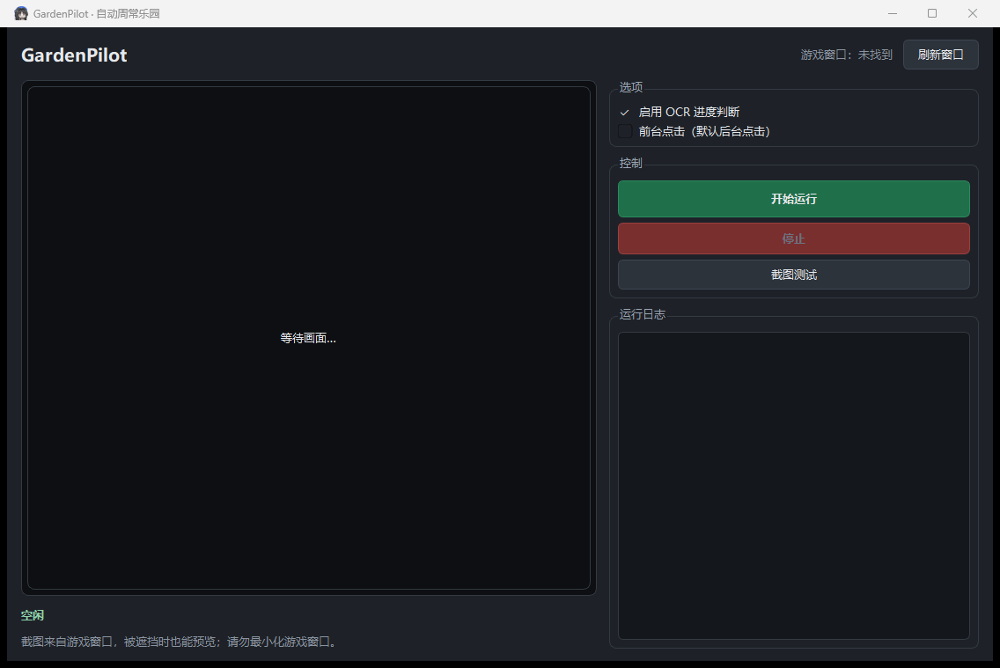

# GardenPilot

一个只做《鸣潮》周常乐园（自动周常乐园）的独立小工具，自带图形界面，Windows 后台运行。

不依赖 ok-script / ok-ww 框架：窗口截图用 Win32 PrintWindow + BitBlt，识别用 OpenCV 模板匹配，
点击和按键通过 PostMessage 发送，画面和日志都在自己的 Qt 界面里显示。

## 直接使用

双击 GardenPilot.exe（或桌面快捷方式），先启动鸣潮并进入大世界，然后点「开始运行」。

界面功能：

- 开始 / 停止
- 游戏画面实时预览，识别到的目标会画框
- 当前动作状态与运行日志
- 截图测试（保存到 logs/garden_frame.png）
- 开关：OCR 进度判断、前台点击

## 从源码运行

需要 Python 3.12：

    python -m pip install -r requirements.txt
    python garden_app.py

命令行版本：

    python run_garden.py
    python run_garden.py --dry-run
    python run_garden.py --no-ocr
    python run_garden.py --foreground

## 打包 exe

    python -m pip install pyinstaller
    pyinstaller --noconfirm --clean GardenPilot.spec

产物在 dist/GardenPilot/，整个目录一起拷贝即可使用。
spec 会过滤掉打包时混入的旧 VC/UCRT 与 ICU DLL，改用系统自带版本；
目标机器需要常规的 VC++ 2015-2022 运行库（多数游戏电脑已具备）。

## 目录

| 路径 | 作用 |
| --- | --- |
| garden_app.py | Qt 界面入口 |
| run_garden.py | 命令行入口 |
| garden_pilot/window.py | 查找游戏窗口、客户端尺寸与偏移 |
| garden_pilot/capture.py | PrintWindow + BitBlt 截图，缩放到 1920x1080 |
| garden_pilot/features.py | 解析 assets/templates 中的模板坐标 |
| garden_pilot/vision.py | OpenCV 模板匹配与 NMS |
| garden_pilot/input.py | PostMessage 键鼠输入，可选前台模式 |
| garden_pilot/ocr.py | onnxocr(OpenVINO) 文本识别 |
| garden_pilot/runner.py | 乐园状态机 |
| garden_pilot/paths.py | 源码 / 打包后统一的资源与日志路径 |
| selftest.py | 不需要游戏的离线自检 |

## 自检

    python selftest.py
    python selftest.py --ocr

会验证模板加载、匹配几何、搜索范围放大、多目标 NMS、状态机核心逻辑，以及 OCR 能否读出 6000。

## 注意

- 游戏窗口不要最小化；被其他窗口遮挡时仍可截图。
- 默认游戏按键未改：F2 打开索拉指南，ESC 返回。
- 模板坐标以 1920x1080 为准，其他 16:9 分辨率会先缩放截图。
- 识别素材来自 ok-ww 项目（AGPL-3.0），见 assets/LICENSE-ok-ww.txt。
